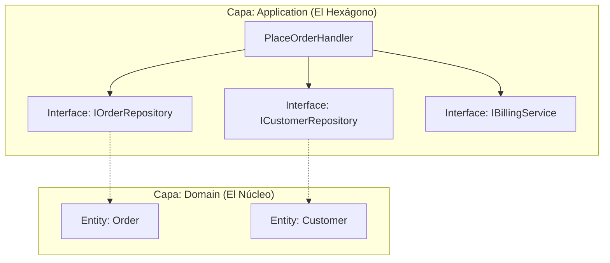

# Tema 4

**Bloque 4: Arquitectura Hexagonal y Monolito Modular**

## Índice

**Manual I: Puertos, Adaptadores y Clean Architecture en Monolitos**

1. Fundamentos de la Separación de Preocupaciones en .NET 10
2. Arquitectura Hexagonal: Puertos y Adaptadores
3. Clean Architecture en el Ecosistema .NET
4. El Monolito Modular como Evolución Arquitectónica
5. Ejemplos de Estructuración, Flujo y Verificación

**Cuadernillos del Alumno (laboratorio)**

- 4.1 Definir Puertos de Salida y Contratos
- 4.2 Implementación de Adaptadores y Reset de Infraestructura
- 4.3 Puertos de Entrada y Tests de Integración

---

# Manual I: Puertos, Adaptadores y Clean Architecture en Monolitos

## 1. Fundamentos de la Separación de Preocupaciones en .NET 10

### 1.1. El problema del acoplamiento en arquitecturas tradicionales

Durante décadas, el desarrollo de software empresarial se ha basado en la arquitectura de tres capas (N-Tier): Presentación, Lógica de Negocio y Acceso a Datos. En este modelo tradicional, la capa de Presentación depende de la Lógica de Negocio, y la Lógica de Negocio depende directamente de la capa de Acceso a Datos. Aunque esta estructura proporciona una separación básica, introduce un defecto arquitectónico fundamental: el acoplamiento transitivo hacia la infraestructura.

En una arquitectura N-Tier clásica, las reglas centrales de la aplicación (el núcleo del negocio) están obligadas a conocer los detalles de cómo se persisten los datos. Si la capa de Acceso a Datos utiliza una biblioteca específica para conectarse a SQL Server, la Lógica de Negocio, al depender de ella, queda indirectamente acoplada a esa tecnología. Este diseño viola el Principio de Inversión de Dependencias (Dependency Inversion Principle), ya que los módulos de alto nivel (las reglas de negocio) dependen de los módulos de bajo nivel (la base de datos).

Este acoplamiento genera múltiples problemas operativos y de mantenimiento. En primer lugar, dificulta enormemente la realización de pruebas unitarias. Para probar una regla de negocio, el desarrollador se ve obligado a levantar una base de datos real o a crear simulaciones (mocks) extremadamente complejas de las herramientas de acceso a datos. En segundo lugar, cualquier cambio en los requisitos de infraestructura, como migrar de una base de datos relacional a una solución NoSQL, provoca un efecto cascada que obliga a reescribir gran parte de la lógica de negocio, incrementando los costes y el riesgo de introducir errores.

### 1.2. La filosofía del aislamiento del núcleo de negocio

Para resolver los problemas del acoplamiento tradicional, las arquitecturas centradas en el dominio adoptan una filosofía distinta: el aislamiento del núcleo de negocio. Esta filosofía dicta que las reglas, entidades y casos de uso de la aplicación deben ser el centro del sistema y no deben tener ninguna dependencia hacia el mundo exterior.

El núcleo de negocio no debe saber si la aplicación es una API REST, un servicio gRPC, una aplicación de consola o una tarea en segundo plano. Tampoco debe saber si los datos se guardan en SQL Server, PostgreSQL, MongoDB o si se envían a través de un bus de mensajes. El núcleo debe ser "agnóstico" a la infraestructura y a los frameworks de entrega.

Este aislamiento se logra invirtiendo la dirección de las dependencias. En lugar de que el negocio dependa de la base de datos, es la base de datos (o más bien, el código que interactúa con ella) la que debe depender del negocio. El núcleo define las reglas y los contratos (interfaces) que necesita para funcionar, y es responsabilidad de las capas externas implementar esos contratos. Esta separación de preocupaciones garantiza que el software sea altamente testable, mantenible y resistente a los cambios tecnológicos, permitiendo que las decisiones sobre frameworks y bases de datos se pospongan o modifiquen sin afectar el valor real de la aplicación: sus reglas de negocio.

## 2. Arquitectura Hexagonal: Puertos y Adaptadores

### 2.1. Concepto central: El hexágono y sus fronteras

La Arquitectura Hexagonal, formalmente conocida como el patrón de Puertos y Adaptadores (Ports and Adapters), fue concebida por Alistair Cockburn con un objetivo claro: permitir que una aplicación sea utilizada de la misma forma por usuarios, programas, pruebas automatizadas o scripts, y que pueda ser desarrollada y probada de forma aislada de sus eventuales dispositivos y bases de datos en tiempo de ejecución.

El uso de un hexágono como representación visual no implica que existan exactamente seis componentes o capas. El hexágono se utiliza simplemente para ilustrar que una aplicación tiene múltiples puntos de entrada y salida, rompiendo con la visión unidimensional de "arriba hacia abajo" de las arquitecturas en capas. El interior del hexágono representa el núcleo de la aplicación (el dominio y los casos de uso). Las aristas del hexágono representan las fronteras de la aplicación, donde el núcleo se comunica con el mundo exterior.

Todo lo que está dentro del hexágono es código puro de C# que modela el negocio. Todo lo que está fuera del hexágono son tecnologías específicas: ASP.NET Core, Entity Framework Core, clientes HTTP, sistemas de archivos, etc. La regla de oro de esta arquitectura es que nada dentro del hexágono puede hacer referencia a nada que esté fuera de él.

### 2.2. Puertos de Entrada (Driving Ports) y Casos de Uso

Para que el mundo exterior pueda interactuar con el núcleo de la aplicación sin acoplarse a su implementación interna, la Arquitectura Hexagonal utiliza Puertos de Entrada, también conocidos como "Driving Ports" (Puertos Conductores).

Un Puerto de Entrada es una interfaz definida dentro del hexágono que expone una funcionalidad específica del negocio. Representa un "Caso de Uso" de la aplicación. Por ejemplo, si el sistema permite registrar un nuevo usuario, existirá un Puerto de Entrada (una interfaz en C#) llamado `IRegisterUserUseCase`. Esta interfaz define el contrato: qué datos de entrada se requieren y qué resultado se devuelve, utilizando únicamente tipos de datos primitivos o clases definidas dentro del propio hexágono.

El Puerto de Entrada es implementado por una clase concreta dentro del hexágono (el servicio de aplicación o el manejador del caso de uso). El mundo exterior (por ejemplo, un controlador de una API) utiliza esta interfaz para desencadenar la lógica de negocio. De esta manera, el núcleo dicta cómo quiere ser utilizado, y los clientes externos deben adaptarse a ese contrato.

### 2.3. Puertos de Salida (Driven Ports) y Contratos de Infraestructura

Así como el núcleo necesita ser llamado desde el exterior, también necesita interactuar con el exterior para realizar tareas como guardar datos, enviar correos electrónicos o consultar servicios de terceros. Sin embargo, como el núcleo no puede depender de tecnologías externas, utiliza Puertos de Salida, también conocidos como "Driven Ports" (Puertos Conducidos).

Un Puerto de Salida es una interfaz definida dentro del hexágono que especifica una operación que el núcleo necesita que el mundo exterior realice por él. Por ejemplo, el núcleo necesita guardar un usuario, por lo que define una interfaz `IUserRepository` con un método `Save(User user)`. El núcleo no sabe ni le importa cómo se implementará este guardado; solo sabe que, en tiempo de ejecución, alguien proporcionará una implementación que cumpla con este contrato.

Esta es la manifestación práctica del Principio de Inversión de Dependencias. El núcleo de negocio es el dueño de la interfaz (el Puerto de Salida), y la infraestructura externa está obligada a implementar esa interfaz. Si en el futuro se decide cambiar la base de datos, el núcleo no sufre ninguna modificación, ya que el contrato (el Puerto de Salida) permanece inalterado.

### 2.4. Adaptadores: Conectando el mundo exterior con el núcleo

Los Adaptadores son los componentes que se sitúan fuera del hexágono y actúan como traductores entre las tecnologías externas y los Puertos definidos por el núcleo. Existen dos tipos de adaptadores, correspondientes a los dos tipos de puertos:

1. **Adaptadores Primarios (Driving Adapters):** Son los componentes que inician la interacción con la aplicación. Toman la entrada de una tecnología específica (como una solicitud HTTP, un mensaje de una cola o un comando de consola), la traducen a los parámetros que requiere el Puerto de Entrada, y llaman a dicho puerto. Un ejemplo clásico en .NET 10 es un `Controller` de ASP.NET Core o un endpoint de Minimal APIs. El controlador extrae los datos del JSON de la petición HTTP y se los pasa al caso de uso.
2. **Adaptadores Secundarios (Driven Adapters):** Son los componentes que implementan los Puertos de Salida. Reciben peticiones desde el núcleo de la aplicación y las traducen a las operaciones específicas de una tecnología externa. Un ejemplo es una clase `SqlUserRepository` que implementa la interfaz `IUserRepository` utilizando Entity Framework Core para generar sentencias SQL y comunicarse con la base de datos.

La separación estricta entre Puertos y Adaptadores permite que una misma aplicación pueda tener múltiples adaptadores para un mismo puerto. Por ejemplo, el mismo Puerto de Entrada podría ser invocado por un adaptador REST y por un adaptador gRPC simultáneamente, sin que el núcleo note la diferencia.

## 3. Clean Architecture en el Ecosistema .NET

### 3.1. Estructura conceptual y la Regla de Dependencia

Clean Architecture, popularizada por Robert C. Martin (Uncle Bob), es una evolución y estandarización de los conceptos presentes en la Arquitectura Hexagonal y otras arquitecturas centradas en el dominio. Su representación visual más conocida es una serie de círculos concéntricos que representan diferentes áreas de software.

En el centro se encuentran las Entidades (Entities), que encapsulan las reglas de negocio empresariales más generales y de alto nivel. En el siguiente círculo están los Casos de Uso (Use Cases), que contienen las reglas de negocio específicas de la aplicación. El tercer círculo corresponde a los Adaptadores de Interfaz (Interface Adapters), como controladores, presentadores y gateways. El círculo más externo contiene los Frameworks y Drivers, como la base de datos, la interfaz de usuario y los dispositivos externos.

El principio fundamental que hace funcionar a Clean Architecture es la **Regla de Dependencia** (The Dependency Rule): las dependencias del código fuente solo pueden apuntar hacia adentro. Nada en un círculo interno puede saber absolutamente nada sobre algo en un círculo externo. Esto significa que las Entidades no saben nada de los Casos de Uso, los Casos de Uso no saben nada de los Controladores, y los Controladores no saben nada de la Base de Datos. Esta regla garantiza que las políticas de alto nivel (el negocio) estén completamente protegidas de los cambios en los detalles de bajo nivel (la infraestructura).

### 3.2. Organización de proyectos y capas en una solución .NET 10

Para aplicar Clean Architecture en una solución real de .NET 10, los círculos conceptuales se traducen típicamente en proyectos separados dentro de una misma solución (en .NET 10, `dotnet new sln` genera por defecto el formato `.slnx`). Esta separación física mediante proyectos hace que el compilador ayude a imponer la Regla de Dependencia: un proyecto solo puede usar los tipos públicos de los proyectos que referencia, y las referencias circulares entre proyectos no se admiten. Lo que el compilador no impide es añadir una referencia indebida en un `.csproj`; para detectarlo se usan pruebas de arquitectura (sección 5.4).

Una estructura estándar en .NET 10 se divide en los siguientes proyectos:

1. **`Proyecto.Domain` (Círculo central):** Este proyecto no tiene dependencias de ningún otro proyecto de la solución ni de paquetes NuGet de infraestructura (como Entity Framework). Contiene las Entidades del dominio, Objetos de Valor (Value Objects), enumeraciones y excepciones de dominio.
2. **`Proyecto.Application` (Casos de Uso):** Su única dependencia de proyecto es `Domain` (y, como mucho, paquetes de abstracciones como `Microsoft.Extensions.DependencyInjection.Abstractions` para su método de registro). Contiene la implementación de los casos de uso, los DTOs (Data Transfer Objects) y las validaciones de aplicación. Aquí residen los Puertos de Entrada (interfaces de los casos de uso) y los Puertos de Salida (interfaces de repositorios y de servicios externos). Muchas plantillas colocan las interfaces de repositorio en `Domain`; las dos opciones respetan la Regla de Dependencia, y lo importante es elegir una y aplicarla en toda la solución. En este manual, todos los puertos viven en `Application`, en las carpetas `Ports/Input` y `Ports/Output`. Los casos de uso pueden organizarse como comandos y consultas con clases propias; no hace falta ninguna biblioteca de mediador (si se usa MediatR, hay que tener en cuenta que desde su versión 13 tiene licencia comercial).
3. **`Proyecto.Infrastructure` (Adaptadores y Frameworks):** Depende del proyecto `Application` (y transitivamente de `Domain`). Contiene las implementaciones concretas de las interfaces definidas en las capas internas. Aquí se ubica el `DbContext` de Entity Framework Core, las migraciones, los clientes HTTP para APIs externas y las implementaciones de repositorios.
4. **`Proyecto.Api` o `Proyecto.Presentation` (Capa externa):** Es el punto de entrada de la aplicación (el ejecutable). Depende de `Application` y de `Infrastructure`. Contiene los Controladores, Minimal APIs, Middlewares y la configuración de Inyección de Dependencias. La dependencia hacia `Infrastructure` existe únicamente para poder registrar las implementaciones concretas en el contenedor de dependencias de .NET durante el arranque de la aplicación; el código de los controladores nunca debe instanciar clases de infraestructura directamente.

### 3.3. Flujo de control vs. Flujo de dependencias (Inversión de Dependencias)

Uno de los conceptos más difíciles de asimilar al adoptar Clean Architecture es la diferencia entre el flujo de control en tiempo de ejecución y el flujo de dependencias en tiempo de compilación.

En tiempo de ejecución, el flujo de control comienza en el exterior y viaja hacia el interior, y luego vuelve a salir. Por ejemplo, una petición HTTP llega al Controlador (Capa API). El Controlador llama al Caso de Uso (Capa Application). El Caso de Uso realiza su lógica y luego llama al Repositorio para guardar los datos. El Repositorio (Capa Infrastructure) ejecuta la consulta en la base de datos. El flujo de control es: `API -> Application -> Infrastructure`.

Sin embargo, si el código fuente siguiera este mismo flujo, `Application` tendría que depender de `Infrastructure`, violando la Regla de Dependencia. Aquí es donde entra en juego la Inversión de Dependencias mediante el uso de interfaces (polimorfismo).

En tiempo de compilación, `Application` define una interfaz `IUserRepository` (un Puerto de Salida). `Infrastructure` implementa esa interfaz en la clase `SqlUserRepository`. Por lo tanto, el código fuente de `Infrastructure` depende de `Application` (para conocer la interfaz que debe implementar). El flujo de dependencias es: `Infrastructure -> Application`.

Gracias a la Inyección de Dependencias nativa de .NET 10, en tiempo de ejecución el contenedor inyecta la instancia de `SqlUserRepository` allí donde se solicita un `IUserRepository`. El Caso de Uso ejecuta el método de la interfaz sin saber qué clase concreta está ejecutando realmente el trabajo. Así, el flujo de control cruza la frontera arquitectónica en dirección opuesta al flujo de dependencias, manteniendo el núcleo completamente aislado.

## 4. El Monolito Modular como Evolución Arquitectónica

### 4.1. ¿Qué es un monolito modular y por qué elegirlo?

El tema 1 presentó el monolito modular como punto intermedio entre el monolito tradicional y los microservicios: se despliega como un único proceso, pero su código está dividido en módulos que corresponden a áreas del negocio (los Bounded Contexts del tema 3). Este tema añade la pieza que faltaba: cómo se organiza cada módulo por dentro. La respuesta habitual es que cada módulo aplica los principios de las secciones 2 y 3, con su propio núcleo, sus propios puertos y sus propios adaptadores, de modo que los límites existen en dos direcciones: entre capas (Regla de Dependencia) y entre módulos (contratos públicos).

### 4.2. Establecimiento de límites (Boundaries) entre módulos internos

El éxito de un monolito modular depende enteramente de la rigidez con la que se respeten los límites (boundaries) entre los módulos. En un monolito tradicional, cualquier clase puede instanciar cualquier otra clase, lo que genera un código espagueti. En un monolito modular, cada módulo es una caja negra para los demás.

Para establecer estos límites en .NET 10, se aplican las siguientes reglas conceptuales:

1. **Encapsulamiento estricto:** Si el módulo se divide en varios proyectos, las entidades y las interfaces de los casos de uso deben ser `public` para poder interactuar entre las capas del módulo. El aislamiento frente a otros módulos se garantiza evitando referencias entre sus proyectos y mediante pruebas de arquitectura. Solo si el módulo entero se agrupa en un único proyecto se puede usar `internal` para todas sus clases.
2. **APIs Públicas por Módulo:** Si un módulo necesita exponer funcionalidad a otros módulos, debe hacerlo a través de una interfaz pública explícita (un contrato). Por ejemplo, si el módulo de "Ventas" necesita verificar el stock, no debe acceder a la base de datos de "Inventario" ni instanciar sus servicios internos. Debe llamar a una interfaz `IInventoryModuleApi` expuesta públicamente por el módulo de Inventario.
3. **Comunicación por Contratos:** Los módulos se comunican entre sí pasando objetos de transferencia de datos (DTOs) simples, nunca pasando entidades de dominio. Pasar entidades acoplaría el modelo de datos de un módulo con el de otro.

### 4.3. Organización de la solución y aislamiento de datos por módulo

En un monolito modular, cada módulo interno implementa su propia Clean Architecture. No existe una única capa de "Dominio" para toda la empresa, sino un Dominio para Ventas, un Dominio para Inventario y un Dominio para Facturación.

A nivel de solución en .NET 10, esto se organiza agrupando los proyectos por módulo en lugar de por capa técnica. Dentro de la carpeta `Modules/Sales`, encontraremos `Sales.Domain`, `Sales.Application` y `Sales.Infrastructure`. Esta estructura vertical asegura que los cambios en el módulo de Ventas no afecten en absoluto al módulo de Inventario.

El aislamiento más crítico en un monolito modular es el aislamiento de datos. Aunque la aplicación se despliegue como un único proceso, los módulos no deben compartir tablas en la base de datos. Cada módulo debe ser dueño exclusivo de sus datos. Esto se puede lograr de varias formas:

- Utilizando bases de datos físicas separadas para cada módulo.
- Utilizando esquemas diferentes dentro de la misma base de datos relacional (por ejemplo, esquema `sales` y esquema `inventory` en SQL Server).
- Utilizando un único esquema, pero con una regla estricta, revisada en cada migración, de que no pueden existir claves foráneas (Foreign Keys) entre tablas de diferentes módulos.

En cualquiera de las opciones, cada módulo tiene su propio `DbContext` y ninguna tabla de un módulo tiene claves foráneas hacia tablas de otro.

Si un módulo necesita datos de otro, debe solicitarlos a través de la API pública del módulo propietario o suscribirse a eventos de integración. La comunicación asíncrona entre estos módulos mediante eventos se abordará en detalle en el tema de Comunicación asíncrona y mensajería en arquitecturas distribuidas.

## 5. Ejemplos de Estructuración, Flujo y Verificación

### 5.1. Ejemplo completo de Puertos y Adaptadores para un proceso de compra

Para ilustrar la Arquitectura Hexagonal, implementaremos de extremo a extremo el caso de uso "realizar un pedido" de un producto. El orden de los bloques sigue el recorrido de dentro hacia fuera: dominio, puertos, caso de uso y adaptadores.

**1. El núcleo del dominio (proyecto `ECommerce.Domain`, sin dependencias):**

```csharp
namespace ECommerce.Domain;

public class DomainException(string message) : Exception(message);

public sealed class Order
{
    public Guid Id { get; private set; }
    public Guid CustomerId { get; private set; }
    public Guid ProductId { get; private set; }
    public int Quantity { get; private set; }
    public DateTime CreatedAtUtc { get; private set; }

    private Order() { } // Para EF Core

    public static Order Place(Guid customerId, Guid productId, int quantity, DateTime nowUtc)
    {
        if (quantity <= 0)
            throw new DomainException("La cantidad debe ser mayor que cero.");

        return new Order
        {
            Id = Guid.NewGuid(),
            CustomerId = customerId,
            ProductId = productId,
            Quantity = quantity,
            CreatedAtUtc = nowUtc
        };
    }
}
```

**2. El Puerto de Entrada (Driving Port), en `ECommerce.Application`:** es el contrato que el mundo exterior debe usar.

```csharp
namespace ECommerce.Application.Ports.Input;

// DTO de entrada del caso de uso (tipos simples, sin nada de HTTP)
public sealed record PlaceOrderRequest(Guid CustomerId, Guid ProductId, int Quantity);

// Puerto de Entrada: interfaz que define el caso de uso
public interface IPlaceOrderUseCase
{
    Task<Guid> ExecuteAsync(PlaceOrderRequest request, CancellationToken cancellationToken);
}
```

**3. El Puerto de Salida (Driven Port), también en `ECommerce.Application`:** es el contrato que el núcleo necesita que la infraestructura implemente.

```csharp
namespace ECommerce.Application.Ports.Output;

using ECommerce.Domain;

public interface IOrderRepository
{
    Task SaveAsync(Order order, CancellationToken cancellationToken);
}
```

**4. La implementación del caso de uso (dentro del hexágono) y su registro.** El caso de uso solo conoce el puerto de salida y `TimeProvider` (la abstracción del reloj incluida en .NET desde la versión 8, que permite fijar la hora en las pruebas).

```csharp
namespace ECommerce.Application.UseCases;

using ECommerce.Application.Ports.Input;
using ECommerce.Application.Ports.Output;
using ECommerce.Domain;

internal sealed class PlaceOrderUseCase(IOrderRepository orders, TimeProvider clock) : IPlaceOrderUseCase
{
    public async Task<Guid> ExecuteAsync(PlaceOrderRequest request, CancellationToken cancellationToken)
    {
        var order = Order.Place(request.CustomerId, request.ProductId, request.Quantity,
            clock.GetUtcNow().UtcDateTime);

        await orders.SaveAsync(order, cancellationToken);

        return order.Id;
    }
}
```

```csharp
// ECommerce.Application/ApplicationServiceCollectionExtensions.cs
// Paquete: Microsoft.Extensions.DependencyInjection.Abstractions
namespace ECommerce.Application;

using ECommerce.Application.Ports.Input;
using ECommerce.Application.UseCases;
using Microsoft.Extensions.DependencyInjection;

public static class ApplicationServiceCollectionExtensions
{
    public static IServiceCollection AddApplication(this IServiceCollection services)
    {
        services.AddScoped<IPlaceOrderUseCase, PlaceOrderUseCase>();
        return services;
    }
}
```

Como `PlaceOrderUseCase` es `internal`, ningún otro proyecto puede instanciarlo: solo pueden pedir `IPlaceOrderUseCase` al contenedor.

**5. El Adaptador Secundario (Driven Adapter), en `ECommerce.Infrastructure`:** implementa el Puerto de Salida con EF Core (paquete `Microsoft.EntityFrameworkCore.SqlServer`).

```csharp
namespace ECommerce.Infrastructure.Persistence;

using ECommerce.Application.Ports.Output;
using ECommerce.Domain;
using Microsoft.EntityFrameworkCore;

internal sealed class AppDbContext(DbContextOptions<AppDbContext> options) : DbContext(options)
{
    public DbSet<Order> Orders => Set<Order>();

    protected override void OnModelCreating(ModelBuilder modelBuilder)
    {
        modelBuilder.Entity<Order>(b =>
        {
            b.ToTable("Orders");
            b.HasKey(o => o.Id);
            b.Property(o => o.Id).ValueGeneratedNever(); // el Id lo genera el dominio
        });
    }
}

internal sealed class SqlOrderRepository(AppDbContext dbContext) : IOrderRepository
{
    public async Task SaveAsync(Order order, CancellationToken cancellationToken)
    {
        dbContext.Orders.Add(order);
        await dbContext.SaveChangesAsync(cancellationToken);
    }
}
```

```csharp
// ECommerce.Infrastructure/InfrastructureServiceCollectionExtensions.cs
namespace ECommerce.Infrastructure;

using ECommerce.Application.Ports.Output;
using ECommerce.Infrastructure.Persistence;
using Microsoft.EntityFrameworkCore;
using Microsoft.Extensions.DependencyInjection;

public static class InfrastructureServiceCollectionExtensions
{
    public static IServiceCollection AddInfrastructure(this IServiceCollection services, string connectionString)
    {
        services.AddDbContext<AppDbContext>(options => options.UseSqlServer(connectionString));
        services.AddScoped<IOrderRepository, SqlOrderRepository>();
        return services;
    }
}
```

**6. El Adaptador Primario (Driving Adapter), en `ECommerce.Api`:** traduce HTTP al Puerto de Entrada. El DTO HTTP es distinto del DTO del caso de uso: sus reglas de formato (atributos de `System.ComponentModel.DataAnnotations`) pertenecen al adaptador. En .NET 10, las Minimal APIs validan esos atributos de forma integrada si se llama a `builder.Services.AddValidation()`, y devuelven `400 Bad Request` con el detalle de los errores. El generador de código que hace posible esta validación solo descubre los tipos del ensamblado en el que se llama a `AddValidation`, otro motivo para declarar el DTO HTTP en el proyecto de la API.

```csharp
// ECommerce.Api/Endpoints/OrderEndpoints.cs
namespace ECommerce.Api.Endpoints;

using System.ComponentModel.DataAnnotations;
using ECommerce.Application.Ports.Input;

public sealed record PlaceOrderHttpRequest(Guid CustomerId, Guid ProductId, [Range(1, 100)] int Quantity);

public static class OrderEndpoints
{
    public static IEndpointRouteBuilder MapOrderEndpoints(this IEndpointRouteBuilder app)
    {
        app.MapPost("/api/orders", async (PlaceOrderHttpRequest body, IPlaceOrderUseCase useCase,
            CancellationToken ct) =>
        {
            // El adaptador primario traduce la petición HTTP y llama al núcleo
            var request = new PlaceOrderRequest(body.CustomerId, body.ProductId, body.Quantity);
            Guid orderId = await useCase.ExecuteAsync(request, ct);
            return Results.Created($"/api/orders/{orderId}", new { OrderId = orderId });
        });

        return app;
    }
}
```

```csharp
// ECommerce.Api/Program.cs (plantilla webapi de .NET 10: incluye Microsoft.AspNetCore.OpenApi)
using ECommerce.Api.Endpoints;
using ECommerce.Application;
using ECommerce.Infrastructure;

var builder = WebApplication.CreateBuilder(args);

var connectionString = builder.Configuration.GetConnectionString("ECommerce")
    ?? throw new InvalidOperationException("Falta la cadena de conexión 'ECommerce'.");

builder.Services.AddOpenApi();
builder.Services.AddValidation();
builder.Services.AddSingleton(TimeProvider.System);
builder.Services.AddApplication();
builder.Services.AddInfrastructure(connectionString);

var app = builder.Build();

if (app.Environment.IsDevelopment())
{
    app.MapOpenApi();
}

app.MapOrderEndpoints();
app.Run();
```

El adaptador primario es también quien traduce los errores de negocio a HTTP: si el caso de uso lanza una excepción de dominio concreta (por ejemplo, stock insuficiente), el endpoint la captura con un `catch` de ese tipo y devuelve `Results.Conflict(ex.Message)` (409), sin capturar `Exception` en general.

El mismo Puerto de Entrada podría usarse desde un controlador MVC, un servicio gRPC o una prueba unitaria sin cambiar ni una línea del caso de uso. Y para probar el caso de uso basta con implementar `IOrderRepository` en memoria y pasar un `TimeProvider` controlado, sin base de datos.

### 5.2. Ejemplo de organización de solución .NET para Clean Architecture

La estructura física de los proyectos es fundamental para garantizar que la Regla de Dependencia se cumpla. A continuación, se muestra cómo se organiza la solución del ejemplo anterior.

```text
ECommerce.slnx
│
├── src/
│   ├── 1. Core/
│   │   ├── ECommerce.Domain/            # Círculo central (sin dependencias)
│   │   │   └── Order.cs                 # Entidades, objetos de valor, DomainException
│   │   │
│   │   └── ECommerce.Application/       # Casos de uso (depende de Domain)
│   │       ├── Ports/Input/             # IPlaceOrderUseCase.cs, PlaceOrderRequest
│   │       ├── Ports/Output/            # IOrderRepository.cs
│   │       ├── UseCases/                # PlaceOrderUseCase.cs (internal)
│   │       └── ApplicationServiceCollectionExtensions.cs
│   │
│   ├── 2. Infrastructure/
│   │   └── ECommerce.Infrastructure/    # Adaptadores secundarios (depende de Application)
│   │       ├── Persistence/             # AppDbContext.cs, SqlOrderRepository.cs
│   │       ├── ExternalServices/        # Pasarela de pago, correo, etc.
│   │       └── InfrastructureServiceCollectionExtensions.cs
│   │
│   └── 3. Presentation/
│       └── ECommerce.Api/               # Adaptadores primarios y arranque (depende de Application e Infrastructure)
│           ├── Endpoints/               # OrderEndpoints.cs
│           ├── Program.cs               # Configuración de la aplicación y DI
│           └── appsettings.json         # Cadenas de conexión y configuración
│
└── tests/
    ├── ECommerce.Application.UnitTests/
    ├── ECommerce.Api.IntegrationTests/
    └── ECommerce.ArchitectureTests/     # Pruebas de la sección 5.4
```

En esta estructura, el proyecto `ECommerce.Api` usa `ECommerce.Infrastructure` únicamente en `Program.cs`, para invocar `AddInfrastructure`. Como `AppDbContext` y `SqlOrderRepository` son `internal`, el resto del código de la API no podría usarlos aunque quisiera: solo interactúa con las interfaces definidas en `ECommerce.Application`.

### 5.3. Ejemplo de contrato público entre módulos

El tema 1 mostró cómo un módulo consume el contrato público de otro dentro del mismo proceso. Cuando cada módulo se divide en varios proyectos (Domain, Application, Infrastructure), el contrato se coloca en un proyecto propio y pequeño, `<Módulo>.Contracts`, que es lo único que los demás módulos pueden referenciar. Así, `Sales.Application` referencia `Inventory.Contracts`, pero nunca `Inventory.Domain`, `Inventory.Application` ni `Inventory.Infrastructure`.

```text
Modules/
├── Inventory/
│   ├── Inventory.Contracts/       # IInventoryModuleApi, StockCheckResult (sin dependencias)
│   ├── Inventory.Domain/
│   ├── Inventory.Application/     # InventoryModuleApi (internal) implementa el contrato
│   └── Inventory.Infrastructure/
└── Sales/
    ├── Sales.Domain/              # incluye OutOfStockException
    ├── Sales.Application/         # referencia Sales.Domain e Inventory.Contracts
    └── Sales.Infrastructure/
```

```csharp
// Inventory.Contracts
namespace Modules.Inventory.Contracts;

// DTO de respuesta: tipos simples, nunca entidades del módulo
public sealed record StockCheckResult(bool IsAvailable, int CurrentStock);

public interface IInventoryModuleApi
{
    Task<StockCheckResult> CheckStockAsync(Guid productId, int requiredQuantity, CancellationToken ct);
}
```

```csharp
// Sales.Domain
namespace Modules.Sales.Domain;

public sealed class OutOfStockException(Guid productId, int available)
    : Exception($"Stock insuficiente para el producto {productId}. Disponible: {available}.")
{
    public Guid ProductId { get; } = productId;
    public int Available { get; } = available;
}
```

```csharp
// Sales.Application: el caso de uso depende solo del contrato de Inventario
namespace Modules.Sales.Application.UseCases;

using Modules.Inventory.Contracts;
using Modules.Sales.Domain;

internal sealed class ReserveStockForOrderUseCase(IInventoryModuleApi inventory)
{
    public async Task EnsureAvailableAsync(Guid productId, int quantity, CancellationToken ct)
    {
        StockCheckResult stock = await inventory.CheckStockAsync(productId, quantity, ct);

        if (!stock.IsAvailable)
        {
            throw new OutOfStockException(productId, stock.CurrentStock);
        }
    }
}
```

La implementación `InventoryModuleApi` es `internal` y la registra el propio módulo de Inventario en su método `AddInventoryModule`, como en el tema 1. Si Inventario se extrajera en el futuro a un servicio independiente, se sustituiría esa implementación por un cliente HTTP o gRPC que cumpla el mismo contrato.

### 5.4. Imponer los límites con pruebas de arquitectura

Las reglas de dependencia solo sirven si se cumplen siempre. Un desarrollador puede añadir por error a `Application` un paquete de EF Core o la referencia al marco de ASP.NET Core, o una referencia de `Sales.Application` a `Inventory.Infrastructure`, y el código seguiría compilando. (Una referencia de `Application` a `Infrastructure` sí la rechaza el SDK con el error `MSB4006`, porque `Infrastructure` ya depende de `Application` y se formaría un ciclo.) Las pruebas de arquitectura son pruebas automáticas que fallan cuando eso ocurre, de modo que la regla se comprueba en cada compilación del pipeline.

La forma más sencilla no necesita paquetes adicionales: un proyecto de pruebas (`dotnet new xunit -n ECommerce.ArchitectureTests`) que referencia los proyectos que quiere inspeccionar y usa reflexión sobre sus ensamblados. `Assembly.GetReferencedAssemblies()` devuelve los ensamblados de los que el código compilado depende realmente; el compilador no incluye las referencias de proyecto que no se usan en el código, así que la prueba detecta dependencias reales, no referencias olvidadas en el `.csproj`.

```csharp
// tests/ECommerce.ArchitectureTests/DependencyRulesTests.cs
using System.Reflection;
using ECommerce.Application.Ports.Input;
using ECommerce.Domain;
using ECommerce.Infrastructure;
using Xunit;

namespace ECommerce.ArchitectureTests;

public class DependencyRulesTests
{
    private static readonly Assembly DomainAssembly = typeof(Order).Assembly;
    private static readonly Assembly ApplicationAssembly = typeof(IPlaceOrderUseCase).Assembly;

    private static List<string> ReferencesOf(Assembly assembly) =>
        assembly.GetReferencedAssemblies().Select(a => a.Name!).ToList();

    [Fact]
    public void Domain_no_depende_de_ningun_proyecto_ni_de_EF_Core()
    {
        var forbidden = ReferencesOf(DomainAssembly)
            .Where(n => n.StartsWith("ECommerce.") || n.StartsWith("Microsoft.EntityFrameworkCore"))
            .ToList();

        Assert.Empty(forbidden);
    }

    [Fact]
    public void Application_no_depende_de_Infrastructure_ni_de_la_Api()
    {
        var references = ReferencesOf(ApplicationAssembly);

        Assert.DoesNotContain("ECommerce.Infrastructure", references);
        Assert.DoesNotContain("ECommerce.Api", references);
        Assert.DoesNotContain(references, n => n.StartsWith("Microsoft.EntityFrameworkCore"));
    }

    [Fact]
    public void Los_adaptadores_secundarios_no_son_publicos()
    {
        var infrastructure = typeof(InfrastructureServiceCollectionExtensions).Assembly;

        // Clases públicas que implementan algún puerto de salida
        var publicAdapters = infrastructure.GetTypes()
            .Where(t => t.IsClass && t.IsPublic
                && t.GetInterfaces().Any(i => i.Namespace == "ECommerce.Application.Ports.Output"))
            .Select(t => t.FullName)
            .ToList();

        Assert.Empty(publicAdapters);
    }
}
```

Las dos primeras pruebas vigilan dependencias entre ensamblados. La tercera inspecciona tipos: `GetTypes()` devuelve todos los tipos del ensamblado, `IsPublic` indica si un tipo de nivel superior es público y `GetInterfaces()` devuelve las interfaces que implementa; con ellas se comprueba que ningún adaptador secundario pueda usarse desde fuera de `Infrastructure` sin pasar por el contenedor. Si alguna prueba falla, el mensaje de xUnit muestra los nombres encontrados.

En un monolito modular, la misma técnica comprueba los límites entre módulos: por ejemplo, que ningún ensamblado cuyo nombre empiece por `Modules.Sales.` referencie un ensamblado de Inventario cuyo nombre no termine en `.Contracts`.

Para reglas más finas (por espacio de nombres o por tipo), existen bibliotecas de terceros como NetArchTest.Rules o ArchUnitNET, que ofrecen una API fluida. Con NetArchTest.Rules, por ejemplo:

```csharp
using NetArchTest.Rules;

var result = Types.InAssembly(typeof(IPlaceOrderUseCase).Assembly)
    .That()
    .ResideInNamespace("ECommerce.Application")
    .ShouldNot()
    .HaveDependencyOn("Microsoft.EntityFrameworkCore")
    .GetResult();

Assert.True(result.IsSuccessful);
```

Antes de adoptar una de estas bibliotecas conviene comprobar su compatibilidad con la versión de .NET del proyecto y su estado de mantenimiento; la variante con reflexión cubre las reglas de dependencia entre proyectos, que son las esenciales de este tema.

---

# Cuadernillos del Alumno (laboratorio)

En esta parte se aplica la teoría de la Parte I sobre el proyecto de ejemplo **B2BOrders**.

---

## Cuadernillo 4.1: Definir Puertos de Salida y Contratos

**Bloque 4: Arquitectura Hexagonal y Monolito Modular** · Duración: 10 min · Nivel: Avanzado

### Objetivos de la Lección

1. Comprender el principio de Inversión de Dependencias (DIP): los módulos de alto nivel no dependen de detalles de bajo nivel.
2. Definir Puertos de Salida (Interfaces) en la capa de Aplicación.
3. Modelar entidades necesarias (`Customer`) para completar los contratos.
4. Desacoplar la lógica de negocio de la infraestructura real (SQL, Stripe, etc.).

### Concepto Clave: Puertos y Adaptadores

En la Arquitectura Hexagonal, tu aplicación no "habla" con la base de datos; habla con un "Puerto".

- **Puerto (Port):** es una Interfaz definida en la capa de Aplicación o Dominio. Define **QUÉ** necesitamos (ej: "Guardar un pedido").
- **Adaptador (Adapter):** es la Implementación real en la capa de Infraestructura. Define **CÓMO** se hace (ej: "Usando EF Core y SQL Server").

> **Regla de Oro:** La capa de Aplicación NUNCA debe mencionar `DbContext`, `SqlConnection` o `HttpClient`. Solo usa interfaces.

### Laboratorio: Definiendo los Contratos

Vamos a trabajar principalmente en la capa `B2BOrders.Application` (y un poco en `Domain` para prerrequisitos).

#### Paso 0: Prerrequisito - La Entidad Cliente (Domain)

Para definir un repositorio de clientes, primero debemos saber qué es un cliente.

**Archivo:** `B2BOrders.Domain/Customers/Customer.cs`

(Si el archivo ya existía pero estaba vacío, actualízalo con este código).

```csharp
namespace B2BOrders.Domain.Customers;

public class Customer
{
    public int Id { get; private set; }
    public string Name { get; private set; } = string.Empty;
    public string Email { get; private set; } = string.Empty;

    // Constructor privado para EF Core
    private Customer() { }

    public Customer(string name, string email)
    {
        if (string.IsNullOrWhiteSpace(name)) throw new ArgumentNullException(nameof(name));
        Name = name;
        Email = email;
    }
}
```

#### Paso 1: El Puerto de Clientes (Application)

La aplicación define que necesita acceder a clientes.

**Archivo:** `B2BOrders.Application/Customers/ICustomerRepository.cs`

```csharp
using B2BOrders.Domain.Customers;

namespace B2BOrders.Application.Customers;

public interface ICustomerRepository
{
    Task<Customer?> GetByIdAsync(int id, CancellationToken cancellationToken);
    Task AddAsync(Customer customer, CancellationToken cancellationToken);
}
```

#### Paso 2: El Puerto de Pedidos (Application)

**Refactorización:** si tenías `IOrderRepository` en el Dominio (del vídeo 3.3), muévelo aquí para centralizar los puertos de salida en la Aplicación (estilo Hexagonal estricto).

**Archivo:** `B2BOrders.Application/Orders/IOrderRepository.cs`

```csharp
using B2BOrders.Domain.Orders;

namespace B2BOrders.Application.Orders;

public interface IOrderRepository
{
    Task AddAsync(Order order, CancellationToken cancellationToken);
    // Task<Order?> GetByIdAsync(int id, CancellationToken cancellationToken); // (Futuro)
}
```

Asegúrate de cambiar el namespace a `B2BOrders.Application.Orders`.

#### Paso 3: El Puerto de Facturación (Application)

Necesitamos cobrar, pero no queremos depender de una pasarela específica.

**Archivo:** `B2BOrders.Application/Billing/IBillingService.cs`

```csharp
namespace B2BOrders.Application.Billing;

// 1. Definimos un DTO de respuesta agnóstico (No depende de Stripe/PayPal)
public record PaymentResult(bool Success, string? TransactionId, string? ErrorMessage);

// 2. Definimos el contrato del servicio
public interface IBillingService
{
    Task<PaymentResult> CreatePaymentAsync(int orderId, decimal amount, string currency);
}
```

### Mapa Visual de la Arquitectura

Así queda nuestro sistema ahora mismo. Observa la dirección de las flechas.



> **Nota:** Aún no existe nadie que implemente estas interfaces. Eso está bien. Compila y es válido.

### Checklist de Verificación

- [ ] He creado la entidad `Customer` en el Dominio.
- [ ] He creado `ICustomerRepository` en `Application/Customers`.
- [ ] He movido/creado `IOrderRepository` en `Application/Orders` y ajustado su namespace.
- [ ] He creado `IBillingService` y el record `PaymentResult` en `Application/Billing`.
- [ ] La solución compila (`dotnet build`) sin errores de referencias.

### Siguiente Paso

Ahora tenemos los enchufes (Puertos) pero nos falta la electricidad.

En el Vídeo 4.2, bajaremos a la capa de Infraestructura (el mundo real) para implementar estos repositorios con Entity Framework Core y crear un adaptador de pagos simulado.

---

## Cuadernillo 4.2: Implementación de Adaptadores y Reset de Infraestructura

**Bloque 4: Arquitectura Hexagonal y Monolito Modular** · Duración: 10 min · Nivel: Avanzado

### Objetivos de la Lección

1. Implementar los Adaptadores reales para los puertos definidos (`ICustomerRepository`, `IOrderRepository`).
2. Crear un Fake Service para simular pagos externos sin dependencias complejas.
3. Configurar la Inyección de Dependencias (DI) en el `Program.cs`.
4. Mantenimiento de Infraestructura: eliminar la base de datos antigua (Legacy) y regenerarla limpia con Migraciones para soportar el nuevo Dominio.

### Laboratorio 1: Código de Infraestructura

En esta fase convertimos las interfaces en código que funciona.

#### 1. Actualización del Contexto (`OrdersDbContext.cs`)

Necesitamos que EF Core entienda nuestra estructura de Dominio (DDD) y la nueva tabla de Clientes.

**Archivo:** `B2BOrders.Infrastructure/OrdersDbContext.cs`

```csharp
public class OrdersDbContext : DbContext
{
    // ... constructor ...

    public DbSet<Order> Orders { get; set; }
    public DbSet<Customer> Customers { get; set; } // <--- Nueva Tabla

    protected override void OnModelCreating(ModelBuilder modelBuilder)
    {
        base.OnModelCreating(modelBuilder);

        // Configuración DDD para Order
        modelBuilder.Entity<Order>(b =>
        {
            b.HasMany(o => o.OrderLines)
                .WithOne()
                .HasForeignKey("OrderId") // Propiedad sombra
                .OnDelete(DeleteBehavior.Cascade);

            b.OwnsOne(o => o.TotalAmount); // Value Object
        });

        // Configuración para OrderLine
        modelBuilder.Entity<OrderLine>(b => b.OwnsOne(ol => ol.UnitPrice));
    }
}
```

#### 2. Los Repositorios (Adaptadores)

Implementamos la lógica de acceso a datos.

**Archivo:** `B2BOrders.Infrastructure/Customers/EfCoreCustomerRepository.cs`

```csharp
public class EfCoreCustomerRepository : ICustomerRepository
{
    // Inyectamos el DbContext
    private readonly OrdersDbContext _context;

    public EfCoreCustomerRepository(OrdersDbContext context) => _context = context;

    public async Task AddAsync(Customer customer, CancellationToken ct)
    {
        await _context.Customers.AddAsync(customer, ct);
        await _context.SaveChangesAsync(ct);
    }

    // ... Implementar GetByIdAsync ...
}
```

(Nota: hacer lo mismo para `EfCoreOrderRepository` en la carpeta `Orders`).

#### 3. El Simulador de Pagos (Fake)

**Archivo:** `B2BOrders.Infrastructure/Billing/FakeBillingService.cs`

```csharp
public class FakeBillingService : IBillingService
{
    public async Task<PaymentResult> CreatePaymentAsync(int orderId, decimal amount, string currency)
    {
        // Simulamos éxito siempre
        return new PaymentResult(true, Guid.NewGuid().ToString(), null);
    }
}
```

#### 4. Composition Root (`Program.cs`)

Registramos los servicios y limpiamos el código antiguo (borramos los endpoints de prueba y el seeding manual).

**Archivo:** `B2BOrders.Api/Program.cs`

```csharp
// ...

// Registro de Adaptadores (Vinculamos Interfaz -> Implementación)
builder.Services.AddScoped<ICustomerRepository, EfCoreCustomerRepository>();
builder.Services.AddScoped<IOrderRepository, EfCoreOrderRepository>();
builder.Services.AddScoped<IBillingService, FakeBillingService>();

// ...
```

### Laboratorio 2: Reset de Base de Datos (Migraciones)

La base de datos actual (`B2BOrders_Perf`) tiene una estructura antigua incompatible con el código nuevo. Vamos a destruirla y regenerarla correctamente.

#### Paso 1: Instalar herramientas necesarias

Para que los comandos funcionen, el proyecto de inicio (Api) necesita las herramientas de diseño.

**Terminal:**

```powershell
dotnet add B2BOrders.Api package Microsoft.EntityFrameworkCore.Design
```

#### Paso 2: Borrado de la Base de Datos (Drop)

Eliminamos la instancia física de SQL Server para evitar conflictos de esquema.

**Terminal:**

```powershell
dotnet ef database drop --project B2BOrders.Infrastructure --startup-project B2BOrders.Api --force
```

#### Paso 3: Crear la Migración Inicial

Generamos el código C# que describe cómo crear las tablas `Orders`, `OrderLines` y `Customers` basándose en nuestro `OrdersDbContext`.

**Terminal:**

```powershell
dotnet ef migrations add InitialArchitecture --project B2BOrders.Infrastructure --startup-project B2BOrders.Api
```

#### Paso 4: Actualizar Base de Datos (Update)

Ejecutamos la migración para crear las tablas físicas en Docker.

**Terminal:**

```powershell
dotnet ef database update --project B2BOrders.Infrastructure --startup-project B2BOrders.Api
```

### Checklist de Verificación

Al terminar este vídeo, tu entorno debe cumplir lo siguiente:

- [ ] `Program.cs` está limpio: ya no hay bucles `for` creando 10,000 pedidos ni endpoints `/orders` con lógica manual.
- [ ] `OrdersDbContext` incluye `DbSet<Customer>`.
- [ ] He ejecutado los comandos de EF Core y han terminado en verde.
- [ ] (Opcional) Si miro SQL Server, veo las tablas `Customers`, `Orders` y `OrderLines` creadas y vacías.

### Siguiente Paso

Ahora tenemos una arquitectura limpia y una base de datos sincronizada (pero vacía).

En el Vídeo 4.3, crearemos el Endpoint `POST /customers` para empezar a meter datos reales y validaremos todo con un Test de Integración completo.

---

## Cuadernillo 4.3: Puertos de Entrada y Tests de Integración

**Bloque 4: Arquitectura Hexagonal y Monolito Modular** · Duración: 10 min · Nivel: Avanzado

### Objetivos de la Lección

1. Abrir el Puerto de Entrada (API) para permitir la creación de clientes.
2. Desacoplar el contrato público (JSON) del comando interno usando DTOs.
3. Implementar Tests de Integración con `WebApplicationFactory` para validar el flujo completo (API → App → DB) sin usar Mocks.

### Laboratorio 1: La Lógica de Aplicación

Antes de exponer nada, necesitamos el "cerebro" que procese la petición.

**Archivo:** `B2BOrders.Application/Customers/Create/CreateCustomerCommand.cs`

```csharp
using MediatR;
using B2BOrders.Domain.Customers; // Asegúrate de tener acceso a la entidad

namespace B2BOrders.Application.Customers.Create;

// 1. El Comando (Intención interna)
public record CreateCustomerCommand(string Name, string Email) : IRequest<int>;

// 2. El Handler (Orquestador)
public class CreateCustomerHandler : IRequestHandler<CreateCustomerCommand, int>
{
    private readonly ICustomerRepository _repository;

    public CreateCustomerHandler(ICustomerRepository repository)
    {
        _repository = repository;
    }

    public async Task<int> Handle(CreateCustomerCommand request, CancellationToken ct)
    {
        // El Dominio protege las reglas (Name no vacío, Email válido...)
        var customer = new Customer(request.Name, request.Email);

        await _repository.AddAsync(customer, ct);

        return customer.Id;
    }
}
```

### Laboratorio 2: El Puerto de Entrada (API)

Exponemos la funcionalidad al mundo exterior usando Minimal APIs.

**Archivo:** `B2BOrders.Api/CustomersEndpoints.cs`

```csharp
using B2BOrders.Application.Customers.Create;
using MediatR;
using Microsoft.AspNetCore.Mvc;

namespace B2BOrders.Api;

public static class CustomersEndpoints
{
    public static void MapCustomersEndpoints(this IEndpointRouteBuilder app)
    {
        app.MapPost("/customers", async (IMediator mediator, [FromBody] CreateCustomerRequest request) =>
        {
            // Mapeo manual: Contrato Público (Request) -> Comando Interno
            var command = new CreateCustomerCommand(request.Name, request.Email);

            var id = await mediator.Send(command);

            return Results.Created($"/customers/{id}", new { Id = id });
        });
    }
}

// DTO Público (Data Transfer Object)
public record CreateCustomerRequest(string Name, string Email);
```

#### Configuración en `Program.cs`

Para que todo funcione, "encendemos" los cables en el arranque.

```csharp
// 1. Registrar MediatR (Buscando handlers en la capa Application)
builder.Services.AddMediatR(cfg => cfg.RegisterServicesFromAssembly(
    typeof(CreateCustomerCommand).Assembly
));

// ...

// 2. Mapear los endpoints antes del Run
app.MapCustomersEndpoints();

app.Run();

// 3. ¡TRUCO VITAL! Exponer la clase Program para los tests de integración
public partial class Program { }
```

### Laboratorio 3: Test de Integración

Validamos que el sistema funciona de verdad, levantando un servidor en memoria.

#### Configuración del Proyecto de Tests

Necesitamos acceso a la API y la librería de testing de ASP.NET Core.

**Terminal:**

```powershell
# 1. Instalar librería de testing
dotnet add B2BOrders.Domain.Tests package Microsoft.AspNetCore.Mvc.Testing

# 2. Referenciar el proyecto API (Para ver la clase Program)
dotnet add B2BOrders.Domain.Tests reference B2BOrders.Api
```

#### El Test (`CustomerIntegrationTests.cs`)

**Archivo:** `B2BOrders.Domain.Tests/CustomerIntegrationTests.cs`

```csharp
using B2BOrders.Api; // Necesario para ver 'Program'
using System.Net.Http.Json;
using Microsoft.AspNetCore.Mvc.Testing;
using Xunit;

namespace B2BOrders.Domain.Tests;

// IClassFixture levanta la API una vez por clase de test (eficiente)
public class CustomerIntegrationTests : IClassFixture<WebApplicationFactory<Program>>
{
    private readonly WebApplicationFactory<Program> _factory;

    public CustomerIntegrationTests(WebApplicationFactory<Program> factory)
    {
        _factory = factory;
    }

    [Fact]
    public async Task CreateCustomer_ShouldReturn201_AndPersistData()
    {
        // Arrange: Crear cliente HTTP simulado
        var client = _factory.CreateClient();
        var request = new { Name = "Integration Test", Email = "test@integration.com" };

        // Act: Llamada HTTP real (en memoria)
        var response = await client.PostAsJsonAsync("/customers", request);

        // Assert: Validar respuesta HTTP
        response.EnsureSuccessStatusCode();
        Assert.Equal(System.Net.HttpStatusCode.Created, response.StatusCode);

        // Assert Extra: Validar que devuelve JSON correcto
        var result = await response.Content.ReadFromJsonAsync<dynamic>();
        Assert.NotNull(result);
    }
}
```

### Guía de Resolución de Problemas (Troubleshooting)

Errores comunes que puedes encontrar y cómo arreglarlos:

| Error                                                     | Causa                                           | Solución                                                                           |
| --------------------------------------------------------- | ----------------------------------------------- | ---------------------------------------------------------------------------------- |
| `Failure to infer parameters... mediator Body (Inferred)` | MediatR no está registrado en el contenedor DI. | Añadir `AddMediatR(...)` en `Program.cs` (ver "Configuración en `Program.cs`").    |
| `CS0246: The type 'Program' could not be found`           | El proyecto de test no ve al proyecto API.      | 1. `dotnet add reference ...Api` · 2. Añadir `using B2BOrders.Api;` en el test.    |
| `404 Not Found` al llamar a `/customers`                  | El endpoint no se ha registrado.                | Asegurar que `app.MapCustomersEndpoints()` está en `Program.cs`.                   |
| `SqlException: Invalid object name 'Customers'`           | La base de datos es antigua.                    | Ejecutar las migraciones como vimos en el vídeo 4.2 (`dotnet ef database update`). |

### Checklist de Verificación

- [ ] `Program.cs` tiene `AddMediatR`, `MapCustomersEndpoints` y `public partial class Program`.
- [ ] `CustomersEndpoints.cs` usa un DTO (`CreateCustomerRequest`) y no el comando directo.
- [ ] El proyecto de tests tiene referencia a `B2BOrders.Api`.
- [ ] `dotnet test` termina en verde (Passed).
